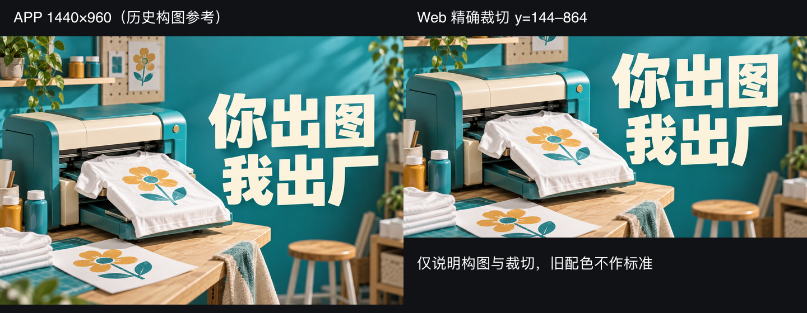
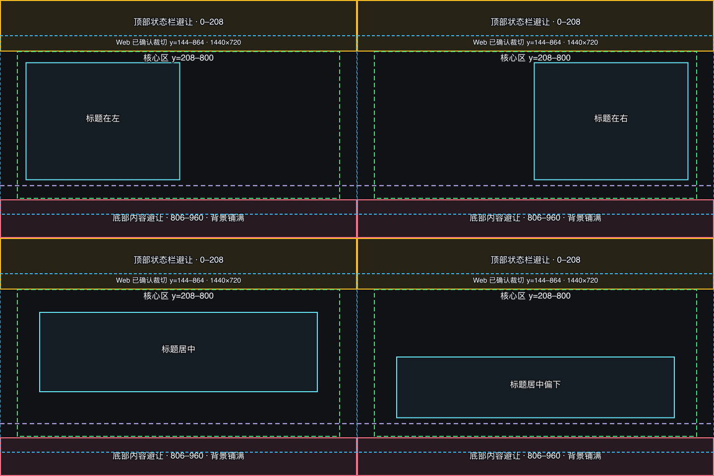
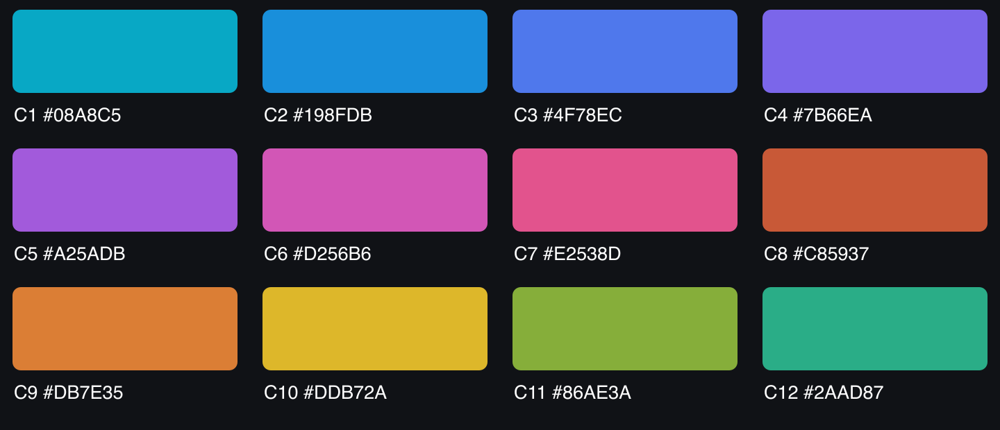

# Banner 规范

# Memebuy 首页 Banner 制作规范

文档版本：1\.2｜更新日期：2026\-10\-08｜适用范围：暗色 App 首页活动 Banner 及同源 Web 裁切

## 什么样的 Banner 可以上线

Banner 应让用户快速理解活动主题、主要价值和点击后的内容。

- **信息准确：**标题、价格、优惠、日期及商品信息经过确认。

- **重点明确：**主标题、辅助说明、主体和装饰有清晰层级。

- **文字可读：**实际页面尺寸下清楚，不依赖放大。

- **内容完整：**重要文字、面部和商品关键细节不被裁切或遮挡。

- **页面协调：**与入口主题色呼应，整体有明确视觉重点和适当留白。

- **交付正确：**尺寸、格式、裁切、跳转目标及版本对应正确。

尺寸合格是基础。好看的 Banner 还应构图自然、色彩协调、信息密度适当，避免多个重点同时争夺注意力。

## 文件尺寸与 App／Web 适配

**Web 必须由 App 主稿精确裁切：**不单独重新生成、重排、拉伸或局部修补。若裁掉重要内容，调整 App 主稿后重新导出两端素材。

Web 按 2:1 完整等比显示，不再进行第二次 cover 裁切。其他比例容器另行评审；文字按实际最小显示宽度检查。

**图1｜App 主稿与 Web 同源裁切。以下沿用旧阅读页中的历史活动图，只说明构图与裁切，旧配色不作为最新标准。**

**尺寸：**App 主稿 1440×960 px（3:2）；Web 1440×720 px（2:1）。两端静态输出均为不透明 PNG，背景铺满四边。

## 安全区与标题布局

坐标均以1440×960 App主稿为准，原点在左上角，x向右、y向下。区间右／下界不包含。

- **顶部避让：**全宽 y=0–208，延续背景，避开重要文字、人物面部等内容；实际设备读取系统安全区。

- **核心构图区：**x=70–1370、y=208–800，安排主要文字和主体关键部位，不要求撑满。

- **底部避让：**全宽 y=806–960，至少154px，对应375px宽页面约40px；仅放背景、低细节纹理或非关键装饰。

- **余量：**y=800–806，不利用这6px塞关键内容；按钮之间的空隙也不例外。

安全区是内容避让，不是空白边。完整文字、描边、阴影、面部和商品关键细节都需要守住边界。Web核心区映射为x=70–1370、y=64–656，上下各64px、左右各70px。

**四种标题位置：**

- 标题在左：x=105–725、y=253–725；主体在右。已确认构图参考。

- 标题在右：x=715–1335、y=253–725；主体在左。已确认构图参考。

- 标题居中：x=160–1280、y=300–620。制作建议。

- 标题居中偏下：x=160–1280、y=480–725。制作建议。

选择一种布局，标题范围包含描边与阴影，不要求撑满。不要压住眼睛、脸部或商品印花，不镜像文字或机械翻转人物五官。

**图2｜四种布局的安全区示意**。按左上、右上、左下、右下排列。黄色为顶部避让，绿色为核心区，青色实框为标题范围，蓝色虚框为Web裁切窗口，粉色为底部避让。紫色虚线为V2\.1页面渐变开始加强的位置 y=748\.8，不是关键内容截止线；进入此区域仍需在真实页面检查。

## 字号与实际尺寸检查（制作建议）

**以375px实际显示宽度为基准：**主标题建议不小于24px，1440px原稿至少93px；常用主标题起点32px，原稿约123px；辅助文案建议不小于15px，原稿至少58px。

主标题建议最多两行。偏下布局高度只有245px，放不下时先精简文案、改为一行或换布局，不通过持续缩字来塞入。

换算公式：原稿字号 ≥ 向上取整（目标显示字号 × 1440 ÷ 实际显示宽度）。更窄展示需重新计算，93／58px不保证任意设备都达到24／15px。

请用100%页面缩放及375×250实际展示检查；70%模拟手机或放大原图不能作为最终字号验收。DPI元数据不会提高缩小后的清晰度。

字号是字体参数，不是可见字形高度。细体、镂空字、复杂纹理和遮罩都可能降低可读性；达到建议下限仍需视觉检查。精确字号以可编辑源稿为准，生成图不能仅靠提示词证明达标。

**图3｜最小字号排版样张。**沿用旧阅读页的可编辑SVG：标题93px、辅助58px；背景更新为V2\.1 C2 \#198FDB。飞书内图片可能随文档宽度缩放，不能用当前图片显示大小代替375px验收。

## V2\.1主题色与首页入口

先选固定主题色，再制作Banner。颜色在背景、标题或主要装饰中清楚呼应，不只藏在小细节里；人物肤色、照片和商品材质可以保持自然色。

每张Banner与双入口预先绑定同一色号。不要从成图自动取色改按钮，也不要为单图临时新增或调整固定色。左侧“定制商品”视觉优先级不低于右侧“设计图案”。

**最新色表：**

- C1 清湖青 \#08A8C5；C2 晴海蓝 \#198FDB；C3 澄蓝 \#4F78EC；C4 柔鸢尾 \#7B66EA。

- C5 绮紫 \#A25ADB；C6 花莓紫 \#D256B6；C7 蔷薇粉 \#E2538D；C8 暖珊瑚 \#C85937。

- C9 杏橙 \#DB7E35；C10 麦芽金 \#DDB72A；C11 嫩橄榄 \#86AE3A；C12 青松绿 \#2AAD87。

Banner内部动画不改变绑定色。左右滑动时，由页面将按钮底色在相邻Banner主题色之间平滑过渡，松手吸附320ms、ease、首尾循环。320ms不是动态素材播放时长，首尾循环也不等于已规定自动轮播。

**图4｜V2\.1最新C1–C12色板**。编号和名称沿用9月21日V2\.0规范，HEX以V2\.1交付为准。现有活动PNG按V2\.1色值重出。

## 页面叠加与真实首页验收

Banner与双主入口叠合，并受到页面底部渐变、滚动遮罩和收起状态影响，必须放入V2\.1真实首页检查。素材内不要烘焙手机框、状态栏、按钮、轮播点、辅助线或页面遮罩，避免重复压暗。

V2\.1基础遮罩：0%–78%透明；86%处12%不透明度；94%处42%；98%处78%；底部100%。渐变开始加强的位置由旧y=633\.6更新为y=748\.8，不改变核心区及154px底部避让。

检查展开、滚动过渡、吸顶和回到顶部状态下的画面。素材制作不改变入口位置、页面组件、Token绑定或交互。涉及正式规范的调整需另行确认。

## 静态与动态 Banner

**静态Banner：**一张图片完整表达主要信息。文字准确、主体清楚、背景铺满，遵守尺寸、裁切、安全区及主题色要求。

**动态Banner首先应是一张合格的静态画面。**首帧尽量完整呈现主要标题、价值信息及关键主体。用户打开App时应立即理解内容，不需要等动画结束。

- 不用黑屏、空背景或核心文字尚未出现的画面开场。

- 关键内容不只在某一瞬间出现；文字保持可读，避免持续抖动、快速移动或反复消失。

- 整个播放过程遵守安全区，运动中的文字、面部和商品细节不越过遮挡边界。

- 动效强化主题和重点，避免多个元素同时运动抢占注意力。

- 若允许循环，检查首尾衔接和连续观看的干扰程度。

**动态 Banner 通用规范：尺寸同静态 Banner，单条视频时长 8～12 秒，MP4 格式，无音轨。当前 Banner 播放完毕一次后，页面自动切换到下一张 Banner，不重复播放当前视频。**

建议交付与首帧一致的完整静态替代图，并保证无声音也能理解内容；这两项属于补充建议，需产品与开发确认实现。网页自动播放可能受浏览器限制，信息不能依赖一定播放成功。

## 制作、修改与交付流程

确认主题、最终文案及换行、辅助说明、原始素材与参考用途、输出范围和跳转目标。不得编造价格、优惠、日期、Logo或商品外观，缺少准确资料先补齐。

**制作顺序：**确认内容 → 选主题色及布局 → 完成App主稿 → 导出Web精确裁切 → 检查两端 → 放入真实首页验收。

使用生成式工具修改时，将新要求整合进提示词，从原始素材或原始文字需求重新生成，不拿上一轮或中间生成图继续生成式重绘。裁切、尺寸适配及非生成式排版可以处理已有图像；不得拉坏人物、商品或文字。

**交付清单：**App/Web PNG/MP4；主题、完整文案、布局编号、色号及HEX。

## 上线验收清单

- App 1440×960、Web 1440×720，静态PNG不透明、铺满四边。

- Web与App指定区域像素完全一致，不二次裁切。

- 无错字、伪文字、遗漏、变形或未经确认的文案。

- 标题及描边阴影符合范围，面部与商品关键细节完整。

- 主题编号与V2\.1 HEX匹配，画面与入口色清楚呼应。

- 实际最小展示宽度下清楚；375px基准按100%页面缩放检查。

- 真实首页遮罩、入口叠加及滚动状态下仍可读。

- 无白边、透明边、明显拼接或烘焙的界面元素。

- 动态首帧完整，全过程可读；冻结的播放参数和失败行为经实际设备验证。

- 活动日期、跳转目标及素材版本正确。

产品经理确认活动内容和范围；设计／美术检查画面、文字及两端效果；开发核对加载、格式、绑定和播放实现；测试验证真实设备及异常情况。

## 🍭Goodcase 记录

（待补充）
